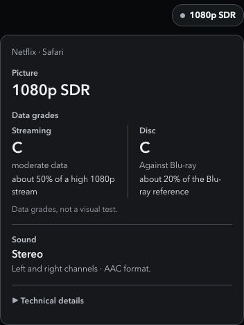

# Stream Quality HUD

A small panel over streaming video that shows what is playing, compares its data with high streaming and disc references, and flags supported playback issues. It works in Chrome as an extension and in Safari as a userscript.



Most streaming players never say which version they picked. Chrome often gets a lower tier than Safari on a Mac, and the player's own menu won't tell you. The HUD reads what the browser already knows about the video and the stream list the service sent, then puts the conclusion in plain words:

- **A button over the video** shows the playing picture or a supported issue. It shows on a known service, or on a video of 10 minutes or more, and fades after 3 seconds of idle while the video plays. Click it, press **Control+Shift+H**, or use the toolbar button to open the panel.
- **Picture first:** decoded resolution and colour range, followed by two visible data grades. The Streaming grade compares this encode with a high streaming reference at the same size; Disc compares with a 1080p Blu-ray reference. Letters, meanings and percentages stay together. They estimate data generosity, not visible picture quality.
- **When grades cannot be calculated**, the grade area names the missing input (video bitrate, frame rate or codec) instead of disappearing or guessing a letter.
- **Sound in plain words:** Stereo means left and right channels; AAC is the audio format. A codec alone never proves a channel count. Missing sound information leaves no empty overview row.
- **Relevant problems only:** the overview calls out a higher version actually sent for this video, a measured playback problem, or a page filter/solid obstruction. Static service ceilings, unsupported audio formats, normal overlays and processing caveats are in **Technical details**.
- **One disclosure:** observed technical values stay available without a legend, repeated “Normal” badges or blank measurements. The panel scrolls when needed, including short windows; refresh preserves its scroll position and the disclosure's focus.

[Interactive examples](docs/preview.html) show both a graded stream and the visible reason when the inputs are unavailable. These examples use synthetic track evidence.

## Install

**Chrome (or another Chromium browser)**
1. Download this repo (Code → Download ZIP) and unzip it.
2. Open `chrome://extensions`, switch on **Developer mode**, click **Load unpacked**, and pick the `extension` folder.
3. On a video page, press **Control+Shift+H** or click the toolbar button.

**Safari**
1. Install the free [Userscripts](https://apps.apple.com/app/userscripts/id1463298887) app and enable it in Safari → Settings → Extensions.
2. Put [`dist/stream-quality-hud.user.js`](dist/stream-quality-hud.user.js) in the Userscripts scripts folder, and allow Userscripts on every website.
3. Reload the video page and press **Control+Shift+H**.

## What it reads, and what it doesn't

- It only reads what the page already has: the `<video>` element, the browser's own playback stats, the stream lists (DASH `.mpd`, HLS `.m3u8`) the page downloaded, and which formats the browser says it can decode.
- **No host permissions, and nothing sent anywhere.** To read a stream list, it asks the browser again for a list the page itself already downloaded, from inside the page with the page's own rights. The browser usually answers that from its cache. It never contacts any other address and never fetches in the background.
- **It never touches sound.** It doesn't create an audio context and doesn't hook the audio path.
- **A verdict needs exact evidence:** the list the video itself is playing (its HLS source, or the list matching its own newest downloads since it started). Without that, it says it can't confirm, rather than guessing.
- **Per-service limits** (for example, Netflix sends Chrome up to 1080p and Safari up to 4K) come from each service's own help pages. Sources and quotes are in [docs/SERVICES.md](docs/SERVICES.md) and [docs/SOUND.md](docs/SOUND.md).

## Develop

- `extension/hud.js` is the whole HUD. It also runs on its own, without extension APIs, which is how the userscript works.
- `tools/build-userscript.sh` rebuilds `dist/stream-quality-hud.user.js` from it.
- **Tests:** 150 silent checks (102 integration and 48 overview/evidence checks), in headless Chromium (the real unpacked extension) and WebKit (the userscript). Every fixture is a synthetic test pattern, and every sound track is digital silence.
  ```
  npm install            # or set PLAYWRIGHT_FROM to a folder that already has playwright-core
  tools/serve-fixtures.sh
  npm test
  ```

## Status

- [x] Chrome extension (Manifest V3), 1.9.0
- [x] Safari userscript, built from the same file
- [x] Current picture, data grades, plain-language sound and technical details
- [x] Published caps for Netflix, Prime Video, Disney+, Hulu, Max, Apple TV+, Paramount+, Peacock, AMC+, MUBI and Criterion Channel
- [x] 150/150 checks
- [ ] Chrome Web Store listing (not planned)

See [docs/DECISIONS.md](docs/DECISIONS.md) for why it works the way it does.

## Licence

MIT
