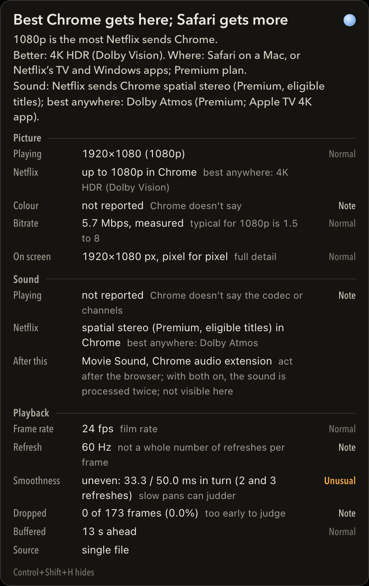
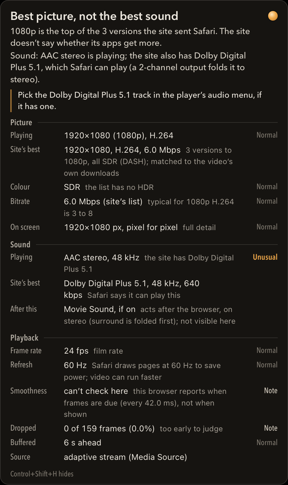
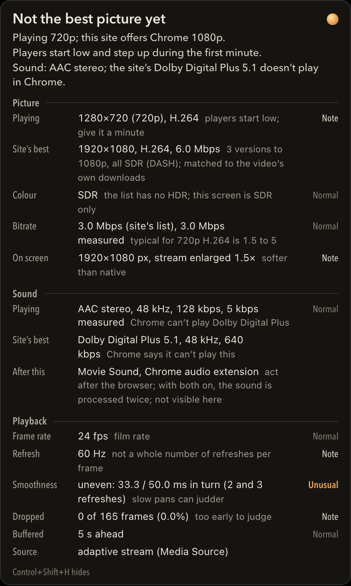
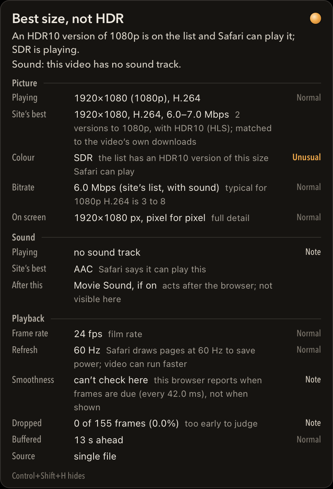

# Stream Quality HUD

A small panel over streaming video that says what is really playing, and whether it's the best version you can get. It works in Chrome as an extension and in Safari as a userscript.



Most streaming players never say which version they picked. Chrome often gets a lower tier than Safari on a Mac, and the player's own menu won't tell you. The HUD reads what the browser already knows about the video and the stream list the site sent, then puts it in plain words:

- **A verdict at the top**, with a cue dot in the corner: best this site offers (sage), best this browser gets but better exists elsewhere (blue), not the best yet (amber), or can't confirm (hollow ring).
- **Picture:** what's playing, the best the site listed, colour (SDR or HDR), bitrate, and whether the screen shows it pixel for pixel.
- **Sound:** the track playing, the best track on the list and whether this browser can decode it, and the service's published sound limits.
- **Playback:** frame rate, screen refresh, smoothness (even or uneven frame pacing), dropped frames and buffer.

Each row is judged **Normal**, **Unusual** or **Note**, with a short reason. Only exceptions get colour.

| Safari, a better sound track exists | Chrome, still stepping up to 1080p | Safari, HDR available but SDR playing |
|---|---|---|
|  |  |  |

## Install

**Chrome (or another Chromium browser)**
1. Download this repo (Code → Download ZIP) and unzip it.
2. Open `chrome://extensions`, switch on **Developer mode**, click **Load unpacked**, and pick the `extension` folder.
3. On a video page, press **Control+Shift+H** or click the toolbar button.

**Safari**
1. Install the free [Userscripts](https://apps.apple.com/app/userscripts/id1463298887) app and enable it in Safari → Settings → Extensions.
2. Put [`dist/stream-quality-hud.user.js`](dist/stream-quality-hud.user.js) in the Userscripts scripts folder, and allow Userscripts on every website.
3. Reload the video page and press **Control+Shift+H**.

## What it reads, and what it doesn't

- It only reads what the page already has: the `<video>` element, the browser's own playback stats, the stream lists (DASH `.mpd`, HLS `.m3u8`) the page downloaded, and which formats the browser says it can decode.
- **No host permissions, and nothing sent anywhere.** To read a stream list, it asks the browser again for a list the page itself already downloaded, from inside the page with the page's own rights. The browser usually answers that from its cache. It never contacts any other address and never fetches in the background.
- **It never touches sound.** It doesn't create an audio context and doesn't hook the audio path.
- **A verdict needs exact evidence:** the list the video itself is playing (its HLS source, or the list matching its own newest downloads since it started). Without that, it says it can't confirm, rather than guessing.
- **Per-service limits** (for example, Netflix sends Chrome up to 1080p and Safari up to 4K) come from each service's own help pages. Sources and quotes are in [docs/SERVICES.md](docs/SERVICES.md) and [docs/SOUND.md](docs/SOUND.md).

## Develop

- `extension/hud.js` is the whole HUD. It also runs on its own, without extension APIs, which is how the userscript works.
- `tools/build-userscript.sh` rebuilds `dist/stream-quality-hud.user.js` from it.
- **Tests:** 45 silent end-to-end checks, in headless Chromium (the real unpacked extension) and WebKit (the userscript). Every fixture is a synthetic test pattern, and every sound track is digital silence.
  ```
  npm install            # or set PLAYWRIGHT_FROM to a folder that already has playwright-core
  tools/serve-fixtures.sh
  npm test
  ```

## Status

- [x] Chrome extension (Manifest V3), 1.5.0
- [x] Safari userscript, built from the same file
- [x] Picture, Sound and Playback judged Normal / Unusual / Note
- [x] Published caps for Netflix, Prime Video, Disney+, Hulu, Max, Apple TV+, Paramount+, Peacock, AMC+, MUBI and Criterion Channel
- [x] 45/45 tests
- [ ] Chrome Web Store listing (not planned)

See [docs/DECISIONS.md](docs/DECISIONS.md) for why it works the way it does.

## Licence

MIT
